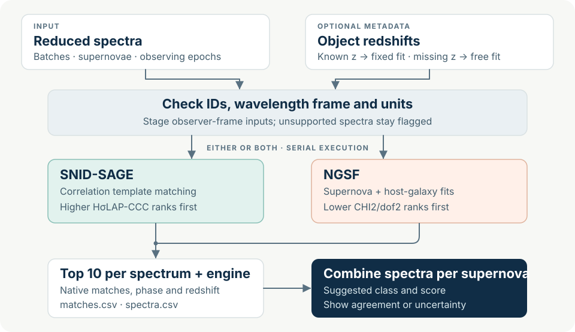

<p align="center">
  
</p>

# Spectypus

**Many spectra. Multiple classifiers. One supernova.**

Spectypus classifies batches of **already reduced supernova spectra** with
SNID-SAGE and NGSF. It saves the top ten matches for each spectrum and combines
evidence across epochs into one reviewable assessment per supernova.

## Why use it?

Replace repeated per-spectrum commands, manual redshift settings and spreadsheet
collation with one input table and one resumable batch. Spectypus routes known/unknown
redshifts, collects native scores, flags disagreements and avoids counting exact
duplicate spectra twice. Verified completed fits are reused after interruption.
**It saves orchestration and bookkeeping; no speedup factor has been benchmarked.**

## How it works



## Choose your classifiers

| Choice | Use it for | Native ranking |
| --- | --- | --- |
| **Both** (default) | Compare engine agreement and disagreements | Separate rankings; combined class support |
| **SNID-SAGE** | Correlation-based spectral template matching | Higher HσLAP-CCC |
| **NGSF** | Supernova + host-galaxy template fitting | Lower `CHI2/dof2` |

Set `enabled: false` on an unwanted engine in `spectypus.local.json`.
SAGE currently uses its optical profile, limited to **z ≤ 1**; unsupported requests
are flagged. Combined support is **not a calibrated probability**.

## Install

Python 3.10 in conda; macOS/Linux.

```bash
git clone git@github.com:sPaMFouR/spectypus.git
cd spectypus
conda env create -f environment.yml
conda activate spectypus
spectypus init --config spectypus.local.json
```

Already set up? Activate `spectypus` and skip creation/init. In the JSON, set both
engines’ `python` paths to the interpreter printed by
`python -c 'import sys; print(sys.executable)'`; set SAGE’s `templates` and NGSF’s
`root`/`parameters`. **Template banks and the NGSF checkout are external.**

## Run a batch

Arrange ASCII spectra as `reduced/<batch>/<object>/<spectrum>.dat`, then:

```bash
spectypus manifest reduced --layout batch-object --frame observer \
  --unit angstrom --output manifest.csv
spectypus plan --manifest manifest.csv --targets targets.csv \
  --config spectypus.local.json --output results/run1
spectypus run --manifest manifest.csv --targets targets.csv \
  --config spectypus.local.json --output results/run1 --max-runs 2
```

Inspect the manifest’s object IDs and wavelength frame before fitting. The optional
[targets table](examples/targets.example.csv) has `object_id,redshift,redshift_source`;
omit `--targets targets.csv` if unavailable. Known redshifts are fixed by default;
missing ones trigger free fits. Remove `--max-runs 2` for the full batch; rerun the
same command to resume.

Results: **`matches.csv`** → top candidates, **`spectra.csv`** → individual spectra,
**`objects.csv`** → combined supernova assessments, plus logs and native evidence.

## View results

```bash
spectypus review --output results/run1
```

Open **http://127.0.0.1:8013** for progress, searchable objects, top matches and
input spectra. Existing environments need `pip install -e '.[web]'` once.
Template overlays are still planned.

[Detailed usage & score semantics](docs/USAGE.md) ·
[Examples](examples/) · [Validation](docs/VALIDATION.md) ·
[Roadmap](docs/roadmap/SPECTYPUS_ROADMAP.md)

**Scope:** reduced spectra, batch classification and local review. Raw-data
reduction and accuracy measurements against independent labels are future work.
