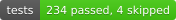
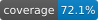
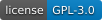

<p align="center">
  
</p>

# Spectypus

[](pyproject.toml) [](https://github.com/doctorbrew/spectypus/actions/workflows/ci.yml) [](https://github.com/doctorbrew/spectypus/actions/workflows/ci.yml) [](https://github.com/doctorbrew/spectypus/actions/workflows/ci.yml) [](LICENSE)

Spectypus classifies reduced supernova spectra with **SNID-SAGE and NGSF**.
Browse template matches in a **SpectralAtlas**, or review a night's observations
in a **Classification Report** with an editable final log.

## One-time setup

```bash
git clone https://github.com/doctorbrew/spectypus.git
cd spectypus
conda env create -f environment.yml
conda activate spectypus
spectypus init --config spectypus.local.json
```

Supply the NGSF source and both classifiers' template banks separately. Set their
paths and the Python interpreter in `spectypus.local.json`; see
[installation details](docs/USAGE.md#install). Check the setup with:

```bash
spectypus doctor --config spectypus.local.json --plots
```

For later runs, just activate the environment. Run from this directory, or add
`--config /path/to/spectypus.local.json` when running elsewhere.

## Build a spectra atlas

Put your reduced ASCII spectra (`.txt`, `.asci`, `.ascii` or `.dat`) in one folder,
then run:

```bash
conda activate spectypus
spectypus night /path/to/spectra --display atlas --output results/atlas
```

Open **`results/atlas/index.html`** in your browser. The atlas includes a searchable
object sidebar, template-match grids and ranked matches. No server is needed.
The folder scan is nonrecursive and uses each filename stem as its object name.

## Build a nightly classification report

For a folder of reduced science spectra:

```bash
conda activate spectypus
spectypus night /path/to/nightly/spectra --display report --output results/night
```

For an EFOSpec night, point to the reduced run folder:

```bash
spectypus night /path/to/EFOSpec/runs/2026-10-28 \
  --display report --output results/2026-10-28
```

EFOSpec inputs automatically select the current science exports and exclude
standards and old revisions. Open **`index.html`** in your chosen output folder
for the Classification Report. Review the matches, edit the final night log and
save it as JSON/CSV. Use **Make plots** in the final log to export selected matches
as 300-dpi JPGs, directly from the browser.

For either workflow, repeat the same command to resume an interrupted run.
Plain folders should contain only science spectra, with observer-frame wavelengths
in Angstroms; use `--frame` and `--unit` for other conventions. Inputs must be
reduced ASCII spectra, not raw data or FITS. For known redshifts and other options,
see the [usage guide](docs/USAGE.md#nightly-folder-command).

Matches are classification candidates for review, not confirmed classifications.
See [validation and limits](docs/VALIDATION.md) for the scientific scope.

## Citation and acknowledgements

Cite the [Spectypus GitHub repository](https://github.com/doctorbrew/spectypus)
and report the version and commit used. See the short [citation guide](docs/CITATION.md) and
[BibTeX references](docs/references.bib) for the classifiers used in your analysis.

We thank the developers of SNID, SNID-SAGE, NGSF and Superfit, the contributors
of reference spectra, and the scientific Python community.

## Help and development

Report problems through [GitHub Issues](https://github.com/doctorbrew/spectypus/issues).
See [contributing](CONTRIBUTING.md) for tests and CI, and the
[usage guide](docs/USAGE.md) for configuration and scientific contracts.
Spectypus is distributed under [GPLv3](LICENSE).
